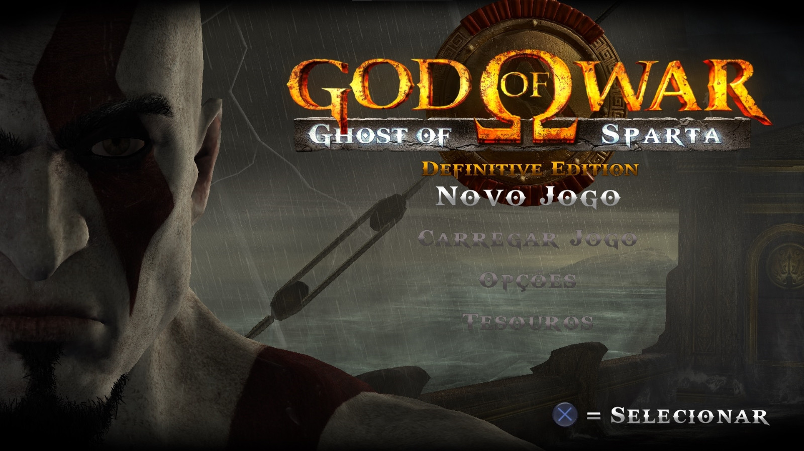
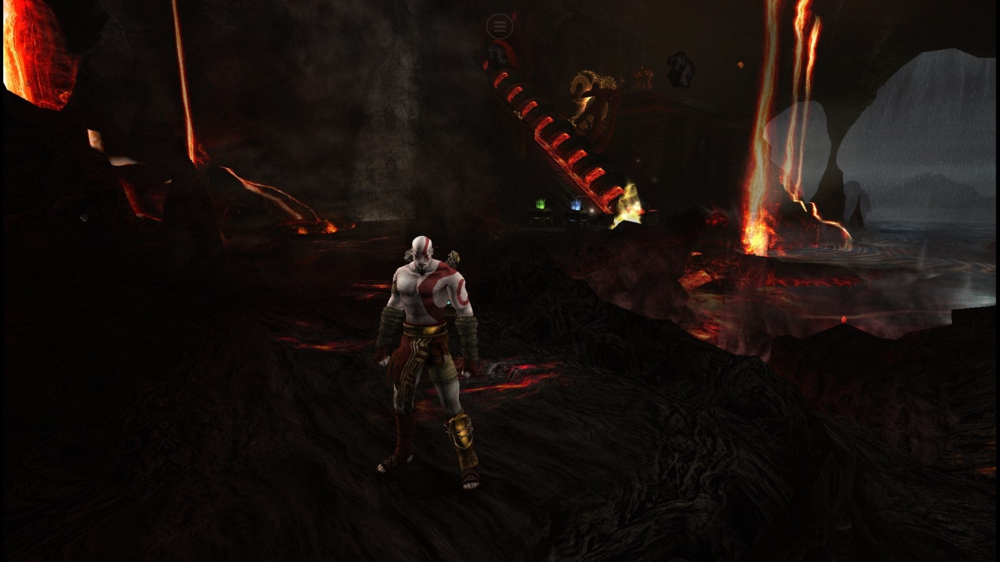
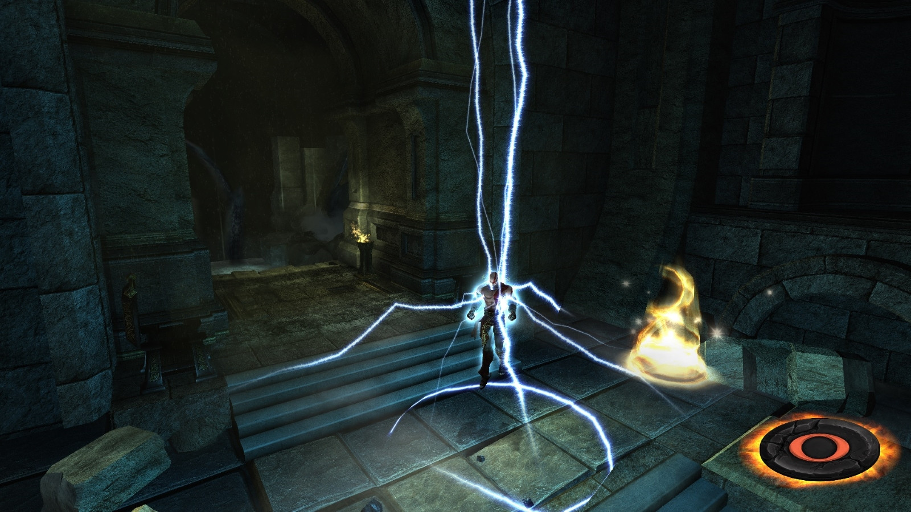
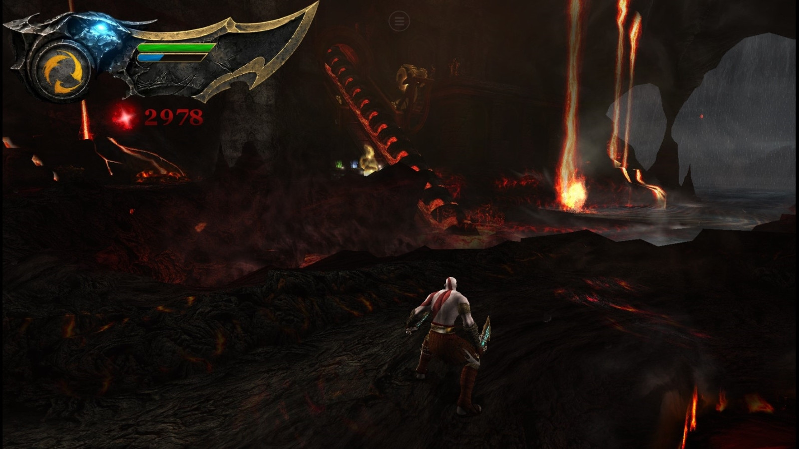
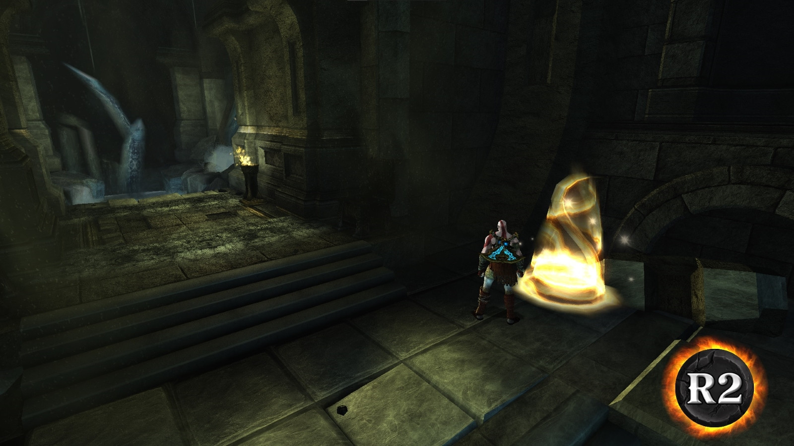

The definitive way for playing God of War: Ghost of Sparta (PSP) on PC.

- HD cutscenes;

- Dodge rolling with the right analog stick;

- Higher-poly, more detailed 3D models;

- Fixed Kratos original weird running animation;

- Kratos no longer looks like he has scoliosis when standing still;

- The blades no longer vanish from his hands onto his back: he now sheathes them just like in GoW III;

- Interacting with objects in the environment and switching weapons is now done with R2, like a console version;

- Magic can now be selected with the D-pad and cast with L2, like in the classic PS2 GoW games;

- The Eye of Atlantis magic has been replaced with Poseidon's Rage, along with the relic's lore, to try to cover the plot hole of Kratos being able to use it at the beginning of GoW II;

- Fear Kratos is now a playable skin;

- New HUD with modernized bars;

- Fixes to the PT-BR patch;

- Blur on distant scenery removed;

- Completion of all the textures missing from the original Definitive Edition texture pack by Modder Espartano.

This mod is not a port or a recomp. It’s an alternate build of PPSSPP that I compiled with the help of AI. Through a hook, it implements things the Ready At Dawn engine can’t do because of the PSP’s limitations, loading external files and running them in real time while the game is open, replacing the original PSP ones.

YOU NEED YOUR OWN ISO TO PLAY. After downloading the 9 parts and extracting them on your PC, the readme file explains how to apply the patch to your legal copy of the game (it must be the clean, unmodified USA version) and get everything working.

Special thanks to Modder Espartano, since 95% of the textures used in the mod are his, and to Flokker for providing files that made developing the animation changes much easier.

Game available in English and PT-BR.

<h2>Screenshots</h2>

  
  

  
  

  

